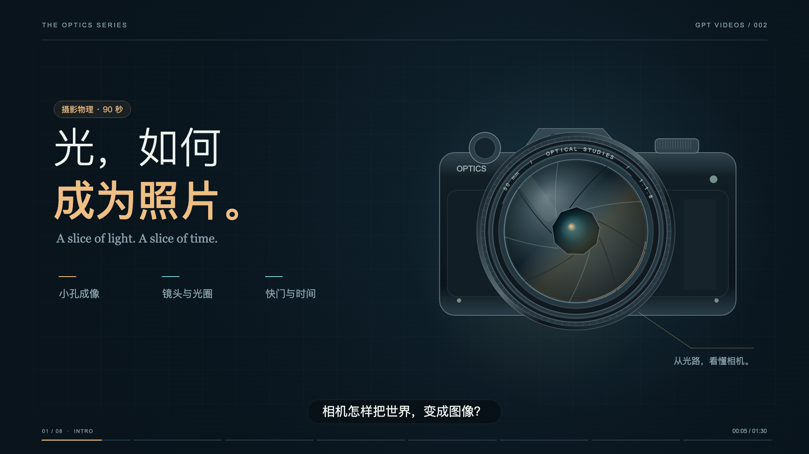
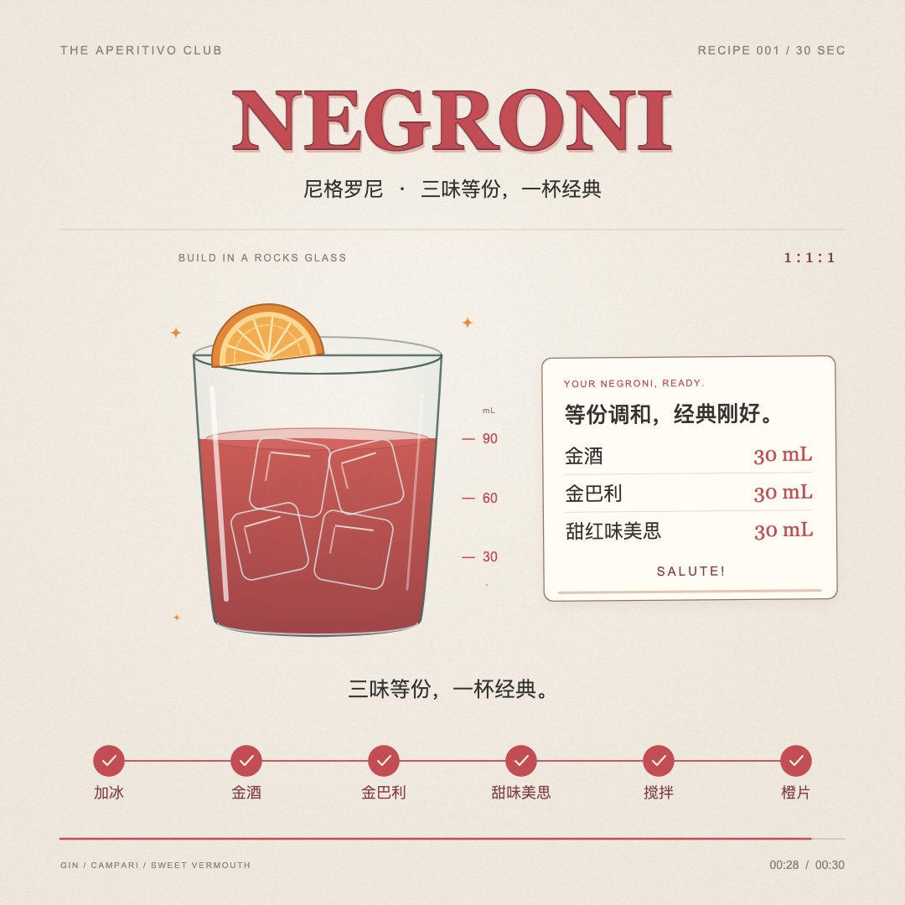

# GPT Videos

用 GPT / Codex 通过代码制作的视频作品集。每个作品保存成片、封面、提示词、动画源码和渲染方法，方便观看、修改与继续创作。

当前收录 **2 个作品**：从一杯 Negroni，到相机里的光与时间。

## 作品

### 002 · 光，如何成为照片

<a href="videos/002-camera-physics/output/camera-physics-90s.mp4"></a>

**[▶ 观看成片](videos/002-camera-physics/output/camera-physics-90s.mp4)** · [下载 MP4](https://raw.githubusercontent.com/seizethemoment/gpt-videos/main/videos/002-camera-physics/output/camera-physics-90s.mp4) · [提示词](prompts/002-camera-physics.md) · [源码与制作说明](videos/002-camera-physics/) · [原理参考](videos/002-camera-physics/sources.md) · [关键帧](videos/002-camera-physics/output/contact-sheet.png)

| 分类 | 时长 | 画面 | 声音 | 日期 |
| --- | --- | --- | --- | --- |
| 摄影物理 / 动画讲解 | 90 秒 · 30 fps | 1920 × 1080 · 中文字幕 | 中文旁白、原创配乐与音效 | 2026-10-19 |

用暖金与青色光路串起小孔成像、镜头对焦、光圈、景深与快门。通过离焦光斑和曝光时间内的运动积分，让成像原理看得见。原理参考 OpenStax《大学物理》、Nikon 和 Cambridge in Colour。

技术：`Canvas 2D` · `JavaScript` · `Python` · `NumPy` · `Playwright` · `FFmpeg` · `edge-tts`

### 001 · NEGRONI — 三味等份，一杯经典

<a href="videos/001-negroni/output/negroni-30s.mp4"></a>

**[▶ 观看成片](videos/001-negroni/output/negroni-30s.mp4)** · [下载 MP4](https://raw.githubusercontent.com/seizethemoment/gpt-videos/main/videos/001-negroni/output/negroni-30s.mp4) · [提示词](prompts/001-negroni.md) · [源码与制作说明](videos/001-negroni/) · [关键帧](videos/001-negroni/output/contact-sheet.png)

| 分类 | 时长 | 画面 | 声音 | 日期 |
| --- | --- | --- | --- | --- |
| 步骤讲解 / 动态插画 | 30 秒 · 30 fps | 1080 × 1080 · 中文字幕 | 原创轻音乐、倒酒与碰冰音效 | 2026-10-19 |

暖白纸张底色与珊瑚红插画，从加冰、倒入三种等份酒液，到搅拌与橙片装饰，完整展示一杯尼格罗尼的制作过程。

技术：`Canvas 2D` · `JavaScript` · `Python` · `NumPy` · `Playwright` · `FFmpeg`

画面由代码绘制，声音由程序合成。动画按绝对时间逐帧渲染，共 900 帧；成片已检查完整解码、浏览器播放与进度拖动。

## 观看与修改

- **直接观看**：点击作品封面或“观看成片”，打开仓库中的 MP4；也可下载到本地播放器。
- **离线预览**：下载整个仓库，双击 [`videos/001-negroni/negroni-offline.html`](videos/001-negroni/negroni-offline.html)。视频与封面已内嵌在文件中。
- **修改动画**：编辑 [`animation.js`](videos/001-negroni/animation.js)，通过 `index.html` 预览，再按作品说明重新渲染。

本地启动播放器只需要 Node.js：

```sh
cd videos/001-negroni
npm start
```

打开终端输出的 `http://127.0.0.1:8790/preview.html`。完整渲染依赖与操作见[作品说明](videos/001-negroni/README.md)。

## 仓库结构

```text
gpt-videos/
├── README.md                  # 作品展示与索引
├── data/videos.json           # 结构化作品信息
├── prompts/                   # 每个作品的制作提示词
└── videos/
    ├── 002-camera-physics/    # 摄影物理原理短片
    └── 001-negroni/
        ├── README.md          # 配方、时间轴、渲染步骤与来源
        ├── animation.js       # 动画绘制
        ├── soundtrack.py      # 音乐与音效
        ├── render.mjs         # 逐帧渲染与 MP4 合成
        ├── serve.mjs          # 本地播放器服务
        ├── index.html         # 实时动画预览
        ├── preview.html       # 视频播放器
        ├── negroni-offline.html
        └── output/            # MP4、封面、关键帧和音轨
```

## 添加下一条视频

1. 在 `videos/` 下创建递增编号的目录，例如 `003-your-title/`，保存源码、说明与成片。
2. 将制作提示词保存到 `prompts/003-your-title.md`。
3. 在 `data/videos.json` 追加作品信息，使用相对于仓库根目录的资源路径。
4. 在本页增加封面、视频入口与作品规格，并更新作品数量。

## 参考与致谢

仓库的作品展示与提示词索引方式参考 [yihui-dev/awesome-opus5-5-videos](https://github.com/yihui-dev/awesome-opus5-5-videos)。

首个作品的创意参考为 [@Ror_Fly 的调酒步骤动画](https://skillry.dev/ai-videos/opus-5-5/ror-fly-880547)（[原帖](https://x.com/Ror_Fly/status/2102853258582880547)）；配方参考 [IBA Negroni](https://iba-world.com/iba-cocktail/negroni/)。本仓库保存的是本次重新设计与编写的作品。
