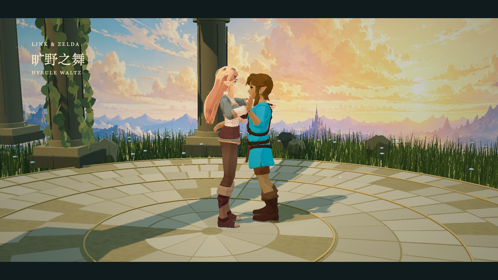

# 旷野之舞 · Hyrule Waltz

[返回作品集](../../README.md) · [制作提示词](../../prompts/003-hyrule-waltz.md) · [角色与素材来源](sources.md)

[](output/hyrule-waltz-36s.mp4)

**[▶ 观看 MP4](output/hyrule-waltz-36s.mp4)** · [下载](https://raw.githubusercontent.com/seizethemoment/gpt-videos/main/videos/003-hyrule-waltz/output/hyrule-waltz-36s.mp4) · [关键帧](output/contact-sheet.png)

36 秒、1920 × 1080、30 fps，H.264 / AAC 双声道。以《旷野之息》的林克与塞尔达为参考，在黄昏的石砌舞台上完成邀舞、双人旋转、抬手转圈与收势，配原创三拍子音乐；塞尔达转身时逐渐微笑，配合自然眨眼。

这是向任天堂游戏视觉靠近的**同人程序动画实验**。角色材质、手指接触、重心与动作细节仍有简化，**未达到任天堂原作级精度**。林克采用原模型改蓝衣的造型，塞尔达采用 Stoff 的长发旅行装；没有使用原作游戏过场画面。

## 时间轴

| 时间 | 舞蹈与镜头 |
| --- | --- |
| 00:00–00:03.6 | 相向靠近、邀舞与片名 |
| 00:03.6–00:14.4 | 三拍起伏、交替落脚、双人自然转 |
| 00:14.4–00:21.6 | 抬手转圈、微笑与眨眼，另一只手放开，镜头靠近 |
| 00:21.6–00:32.4 | 重回合舞，沿石台继续旋转 |
| 00:32.4–00:36 | 放缓、收势、片名与淡出 |

原创配乐：D 大调、100 BPM、3/4、20 小节，钢琴、竖琴、长笛、弦乐与大提琴。

## 观看与重渲染

下载目录后可直接打开 `preview.html` 播放已有 MP4。实时三维版本需要先获取外部角色模型：

```sh
npm ci
python3 fetch_assets.py
npm start
# http://127.0.0.1:8792/preview.html  视频播放器
# http://127.0.0.1:8792/index.html    实时三维画面
```

从相同源码逐帧导出：

```sh
python3 -m pip install -r requirements.txt
# 若本机没有 Chrome：
npx playwright install chromium
npm run preview
npm run render
```

可用 `CHROME_PATH`、`FFMPEG_PATH` 指定浏览器和 FFmpeg。渲染脚本默认使用仓库中的成品音轨。重新生成音轨需要 **macOS、Swift 与系统 General MIDI 音色库**：

```sh
python3 make_audio.py
```

角色模型来自外部来源并有独立的用途限制；原文件未收录到 Git。来源、作者和局限见 [sources.md](sources.md)。

## 修改入口

- `actors.js`：模型加载、材质、骨骼映射、两段式 IK。
- `choreography.js`：三拍步态、落脚目标、牵手与转圈。
- `expressions.js`：塞尔达嘴角、面颊与眼皮骨骼动画；9 次轻柔眨眼。
- `stage.js`：石台、遗迹、草、藤叶、灯光和粒子。
- `animation.js`：镜头、画面合成、片名、淡入淡出。
- `score.py` / `render_audio.swift` / `make_audio.py`：原创乐谱与离线演奏。
- `render.mjs`：1080 帧导出、关键帧、手腕距离采样和完整解码检查。
- `output/render-report.json`：本次实际渲染检查结果。手腕距离仅反映骨骼目标接近程度，不代表手指或布料没有穿插。

[面部表情特写对比](output/expression-sheet.png)：默认、微笑、半眨眼与闭眼。

底图使用内置 imagegen；三维角色保持独立骨骼动画，远景绘画不随人物变形。
